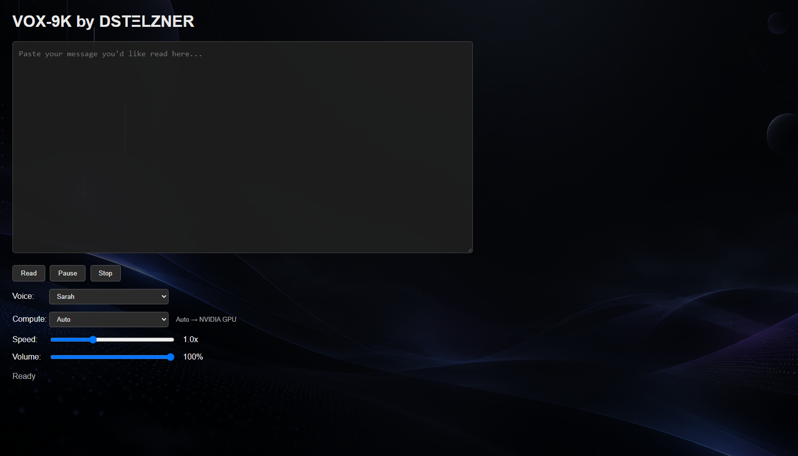

# VOX-9K

**Local neural text-to-speech for long AI, coding, research, and general text prompts.**

VOX-9K is a lightweight local text-to-speech application built around Kokoro neural TTS.

It was originally created to make long ChatGPT and coding responses easier to consume without relying on cloud-based text-to-speech services.

Paste text into the browser interface, choose a voice and compute mode, then let VOX-9K read it locally.

---

## Screenshot



---

## Features

- Local neural text-to-speech
- Kokoro TTS through PyKokoro
- Multiple American and British voices
- Automatic hardware selection
- CPU inference support
- NVIDIA CUDA GPU acceleration
- Manual CPU / GPU selection
- Background generation of upcoming speech chunks
- Fast startup chunking for reduced perceived latency
- Pause and resume from the current playback position
- Stop playback instantly
- Adjustable playback speed
- Adjustable volume
- Sentence-aware text segmentation
- Markdown cleanup for AI and coding responses
- Handles decimal values such as `8.2` without incorrectly splitting sentences
- Replaceable custom background
- No cloud TTS API required

---

## How VOX-9K Works

VOX-9K uses a small local Flask server to run the text-to-speech engine.

The browser interface sends text chunks to the local server, which generates speech using Kokoro.

While the current chunk is playing, VOX-9K begins generating the next chunk in the background.

The current startup strategy uses approximately:

```text
Chunk 1: 150 characters
Chunk 2: 300 characters
Chunk 3+: 700 characters
```

This helps audio begin quickly while allowing the generation pipeline to build enough buffer for continuous playback.

---

## Requirements

### Minimum

- Python 3.10 or newer
- Modern web browser
- CPU capable of running ONNX Runtime
- Internet connection during initial dependency/model setup

### Recommended

- Python 3.12
- NVIDIA RTX GPU for accelerated inference
- Windows 10 or Windows 11

VOX-9K works in CPU mode without an NVIDIA GPU.

---

## Installation

Clone or download the repository.

Open a terminal inside the VOX-9K folder.

### Windows

Create a virtual environment:

```cmd
py -3.12 -m venv .venv
```

Install CPU dependencies:

```cmd
.\.venv\Scripts\python.exe -m pip install -r requirements.txt
```

### macOS / Linux

Create a virtual environment:

```bash
python3 -m venv .venv
```

Activate it:

```bash
source .venv/bin/activate
```

Install CPU dependencies:

```bash
python -m pip install -r requirements.txt
```

---

## NVIDIA GPU Installation

VOX-9K can use NVIDIA CUDA acceleration through PyKokoro's GPU runtime.

PyKokoro's CPU and GPU ONNX Runtime packages are alternatives. Use one provider installation per virtual environment.

If you initially installed the CPU version on Windows, remove the CPU ONNX Runtime package:

```cmd
.\.venv\Scripts\python.exe -m pip uninstall -y onnxruntime
```

Then install the GPU requirements:

```cmd
.\.venv\Scripts\python.exe -m pip install -r requirements-gpu.txt
```

You can check which ONNX providers are available with:

```cmd
.\.venv\Scripts\python.exe -c "import onnxruntime as ort; print(ort.get_available_providers())"
```

A working NVIDIA setup should include:

```text
CUDAExecutionProvider
CPUExecutionProvider
```

---

## Running VOX-9K

### Windows

Start the local server:

```cmd
.\.venv\Scripts\python.exe server.py
```

### macOS / Linux

```bash
python server.py
```

Then open:

```text
http://127.0.0.1:5000
```

in your browser.

Keep the terminal window running while using VOX-9K.

---

## Compute Modes

VOX-9K provides three compute options.

### Auto

```text
Auto
```

Automatically selects the best available inference provider.

If CUDA is available, the interface will display:

```text
Auto → NVIDIA GPU
```

Otherwise it will fall back to CPU:

```text
Auto → CPU
```

### CPU

```text
CPU
```

Forces CPU inference.

This is the most broadly compatible option.

### NVIDIA GPU

```text
NVIDIA GPU
```

Forces CUDA inference when a compatible NVIDIA GPU and runtime are available.

If CUDA is unavailable, the GPU option is disabled.

---

## First-Run Performance

The first text generation after launching VOX-9K may take longer than later generations.

During the first request, the application may need to:

- Initialize ONNX Runtime
- Load the Kokoro model
- Initialize the selected compute provider
- Allocate memory
- Load voice assets
- Populate local caches

Once the engine is warm, subsequent text generation is typically much faster.

This means a cold first generation may take several seconds while later generations can feel nearly instant on sufficiently fast hardware.

---

## Voices

VOX-9K currently exposes several Kokoro voices.

### American Female

- Sarah
- Heart
- Bella
- Nicole
- Nova
- Sky

### American Male

- Michael
- Fenrir
- Puck
- Onyx
- Liam

### British Female

- Emma
- Isabella
- Lily

### British Male

- George
- Fable
- Lewis
- Daniel

The selected voice is locked when playback begins so prefetched audio chunks remain consistent throughout the session.

---

## Custom Background

VOX-9K loads its background from:

```text
background.png
```

To use your own background:

1. Choose a PNG image.
2. Rename it to `background.png`.
3. Replace the existing `background.png` in the VOX-9K folder.
4. Refresh the browser.

Recommended resolution:

```text
1920 x 1080 or higher
```

Dark images generally work best with the current interface overlay.

The included background is only a default theme asset and is not required for VOX-9K's text-to-speech functionality.

---

## Text Processing

VOX-9K performs basic cleanup before sending text to Kokoro.

This includes removing or simplifying common formatting such as:

- Markdown headings
- Markdown bold markers
- Backticks
- Blockquotes
- Bullet markers
- Decorative separator lines

Sentence segmentation uses the browser's `Intl.Segmenter` API rather than simple period-based splitting.

This prevents values such as:

```text
8.2
3.18
1.24
```

from being incorrectly interpreted as sentence boundaries.

---

## Local Processing and Privacy

VOX-9K is designed to run locally.

Text submitted to VOX-9K is sent from the browser interface to the Flask server running on your own computer.

VOX-9K does not require a cloud text-to-speech API.

The Flask server is configured to listen on:

```text
127.0.0.1
```

which limits access to the local machine by default.

---

## Project Structure

```text
VOX-9K/
│
├── index.html
├── server.py
├── background.png
├── screenshot.png
│
├── requirements.txt
├── requirements-gpu.txt
│
├── README.md
├── LICENSE
└── .gitignore
```

The application will also create local runtime directories such as:

```text
.venv/
cache/
temp/
```

These are intentionally excluded from Git through `.gitignore`.

---

## Model Cache

Kokoro model assets are stored locally after they are downloaded.

The model cache is not included in the GitHub repository.

This keeps the repository small and allows dependencies and model assets to be recreated locally during setup.

---

## Known Limitations

VOX-9K is currently an early-stage project.

Known limitations include:

- Cold engine startup can cause noticeable latency on the first generation.
- GPU support depends on compatible NVIDIA and ONNX Runtime configuration.
- Background customization currently requires manually replacing `background.png`.
- The current interface is primarily designed and tested as a local desktop application.
- Hardware and platform testing is still limited.

---

## Roadmap

Potential future improvements include:

- Persistent voice, speed, volume, and compute settings
- Keyboard shortcuts
- Built-in background selector
- Additional themes
- More detailed performance metrics
- Improved streaming
- Additional hardware acceleration support
- Cross-platform testing
- Easier packaged desktop distribution
- Additional text cleanup controls

---

## Built With

- HTML
- CSS
- JavaScript
- Python
- Flask
- PyKokoro
- Kokoro TTS
- ONNX Runtime

---

## Credits

VOX-9K uses the Kokoro text-to-speech model through the PyKokoro Python library.

Kokoro and PyKokoro are separate projects and retain their respective licenses and copyrights.

---

## License

VOX-9K is released under the MIT License.

See the `LICENSE` file for details.

---

## Status

VOX-9K is currently under active development.

Current release target:

```text
v0.1.0
```