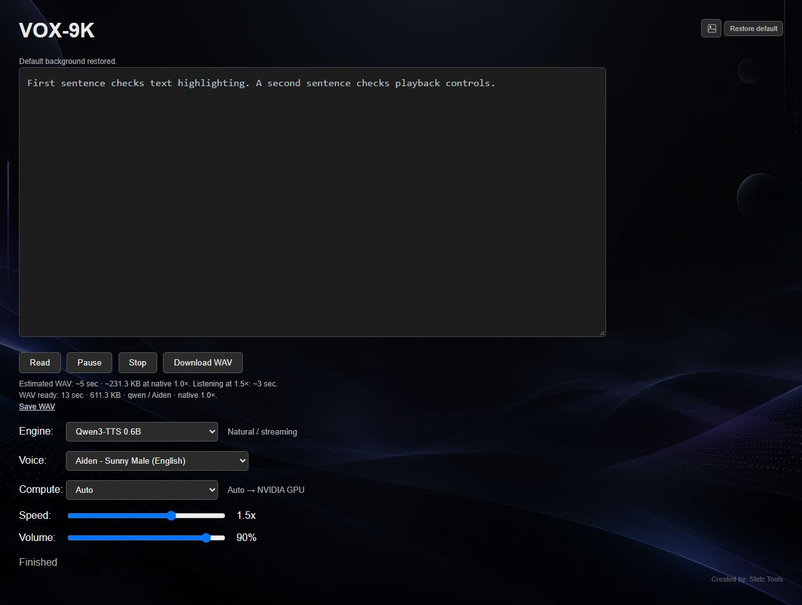

# VOX-9K

**Local neural speech reading for long prompts, coding responses and research text.**

VOX-9K combines a Python backend with a shared browser interface and optional Windows desktop window. It supports Kokoro CPU synthesis and an optional optimized Qwen3-TTS CUDA sidecar.

**Source-based usage:** Python is required. No standalone executable or installer is available.

Current VOX-9K interface with Download WAV, native/listening duration estimates, custom-background controls and the **Created by: Stelz Tools** footer.

## Features

- Kokoro voices and optional Qwen3-TTS 0.6B streaming with Ryan, Aiden and other supported voices.
- Read, Pause, Resume and Stop; voice selection, speed and volume controls.
- Full-text reading progress with chunk-level highlighting and Markdown cleanup.
- Pitch-preserving accelerated Qwen playback with corrected PCM-tail continuity and audio-clock scheduling.
- Complete **Download WAV** export with approximate duration/size before generation and measured values afterward.
- **Change Background** with validated PNG/JPEG/WebP selection, per-user persistence and **Restore default**.
- Native Windows editing menu with Cut, Copy, Paste and Select All; Ctrl+V remains available.
- **188 passing model-free tests**, including real loopback/process integration checks.

## Choose a mode

| Mode | Launch | Requirements |
| --- | --- | --- |
| Browser | Python running server.py, then open http://127.0.0.1:5000 | Python 3.12 and a modern browser |
| Windows desktop | Python running desktop.py | Same backend, optional desktop packages, Microsoft WebView2 and compatible .NET/Windows Forms runtime |

Both modes use the same controls, engines and local services. The desktop launcher owns only the services it starts and closes them with its window. Browser mode remains terminal-owned.

## Windows setup and launch

Clone the repository and open PowerShell in its directory. For Kokoro CPU:

~~~powershell
py -3.12 -m venv .venv
.\.venv\Scripts\python.exe -m pip install -r requirements.txt
~~~

Browser mode:

~~~powershell
.\.venv\Scripts\python.exe server.py
~~~

Open [VOX-9K](http://127.0.0.1:5000) and keep the terminal running.

For the optional Windows window:

~~~powershell
.\.venv\Scripts\python.exe -m pip install -r requirements-desktop.txt
.\.venv\Scripts\python.exe desktop.py
~~~

Initial dependency/model setup may require Internet access and large downloads. Weights are cached locally and are not included in the repository. These recipes have not been rehearsed on a clean machine; see [running instructions](docs/RUNNING.md) and [desktop requirements](docs/DESKTOP.md).

### Optional optimized Qwen (Windows CUDA)

Qwen requires compatible NVIDIA CUDA hardware/drivers and sufficient VRAM. Acceptance used an RTX 3060 with 12 GiB and torch CUDA 12.6; this is a tested configuration, not a minimum-VRAM guarantee.

Keep the optimized stack separate from Kokoro:

~~~powershell
py -3.12 -m venv .venv-fast
.\.venv-fast\Scripts\python.exe -m pip install -r requirements-fast.txt
~~~

The parent detects .venv-fast/Scripts/python.exe and starts the persistent qwen_fast_server.py sidecar. Model loading and CUDA graph warmup occur once per sidecar lifetime. There is no Qwen CPU or Mac backend in this application. Do not mix the older qwen_smoke_test.py setup with the optimized environment.

Kokoro CPU is the verified Kokoro path. The tested ONNX Runtime GPU installation has a CUDA DLL mismatch; Auto reports CPU fallback, and explicit Kokoro CUDA fails clearly. Provider detection alone is not proof of GPU inference. The optional requirements-gpu.txt recipe needs a separately compatible runtime; it is not a verified clean-install promise.

## WAV export

Finish or Stop reading, select engine/voice, and click **Download WAV**. When generation finishes, choose **Save WAV** or click Download WAV again.

- Output is one mono **24 kHz / 16-bit PCM WAV** at **native 1.0x synthesis speed**. Playback speed and volume are not baked into the file.
- Pre-generation duration/size values are approximate heuristics. Final native duration and file bytes are measured from generated audio.
- Generation reports progress, supports cancellation and uses bounded disk-backed output. Completed Qwen playback chunks can be reused.
- Browser download preferences control browser saving; Windows desktop uses the native Save dialog handler.
- Limits include 20,000 cleaned characters, a 64 KiB JSON request body, 96 MiB WAV output and cooperative cancellation. Ready files expire after ten minutes.

See [export behavior, formulas and limits](docs/EXPORT_AND_BACKGROUNDS.md).

## Custom backgrounds and editing

Use the upper-right picture button (**Change Background**) to select a local PNG, JPEG or WebP. Content is decoded and validated, with size/dimension limits; SVG and malformed/animated images are rejected. **Restore default** returns the included artwork.

The custom image persists under per-user application data, normally %LOCALAPPDATA%\VOX-9K on Windows. It does not modify tracked background.png or store a large base64 image in localStorage. Other windows on that backend pick up changes on reload.

Right-click the editable text field for native editing commands in Windows desktop mode. Paste inserts at the cursor or replaces selected text. Stop reading first if the temporary read-progress view is active. Browser mode keeps normal browser editing behavior.

An owner-observed Controlled Folder Access notification blocked WebView2 from modifying Favorites. Its triggering operation is not currently reproducible. No Windows security protection was disabled or bypassed; the background implementation does not need Favorites write access. See [the paste/security findings](docs/PASTE_SECURITY_REPORT.md).

## Validation and limitations

The current suite passes **126 Python + 62 frontend tests = 188**, with no failures or skips:

~~~powershell
.\.venv\Scripts\python.exe -B -m unittest discover -s tests -p 'test_*.py' -v
node --test tests\frontend.test.cjs
~~~

Tests do not load neural models. Real cached-model, native-window, export and owner-listening acceptance are documented separately in [testing](docs/TESTING.md), [Desktop V1](docs/DESKTOP_V1_REPORT.md), [audio corrections](docs/QWEN_AUDIO_REPORT.md), [WAV/background features](docs/FEATURE_REPORT.md) and [native editing](docs/PASTE_SECURITY_REPORT.md).

Known limits:

- Windows Kokoro CPU and Qwen CUDA passed short acceptance; clean-machine installation and macOS/Linux compatibility remain unverified. No Mac desktop/CoreML claim is made.
- Cold model startup takes time. Requirements record the observed setup rather than a freshly validated lockfile.
- Cancellation is cooperative between native steps. Kokoro cannot interrupt an in-flight synthesis call.
- Qwen speed adjustment remains per-buffer WSOLA; short buffers pass through, and difficult/long material may still have artifacts. Prolonged pauses can accumulate queued playback PCM.
- WAV export and playback run one at a time in the same window; separate windows can contend for generation.
- A standalone installer remains future work requiring packaging, native-runtime licensing and clean-machine validation.

## Local processing and licensing

Speech inference runs locally; no cloud TTS API or application telemetry is required. Setup/catalog/model retrieval can use the network. The UI/backend bind loopback on port 5000; optional Qwen uses port 5001. Host/Origin guards restrict unrelated browser sites, but are not authentication against local software under the same account.

Environments, weights, model caches, temporary recordings, custom user images, backups and raw audit evidence are excluded from Git.

Original application code uses the [MIT license](LICENSE). Kokoro/PyKokoro, Qwen/faster-qwen3-tts, pywebview and other dependencies retain their own terms. The owner supplied the included background's ChatGPT-generated provenance and permission to redistribute it with VOX-9K; this does not assert exclusive rights or copyright protection for AI output. See [third-party notices and asset provenance](docs/THIRD_PARTY_NOTICES.md).

Built with Python, Flask, HTML/CSS/JavaScript, ONNX Runtime, FastAPI, PyTorch/CUDA and Web Audio. The earlier [engineering audit](docs/ENGINEERING_AUDIT.md) is a historical baseline; subsequent acceptance reports describe later corrections.
